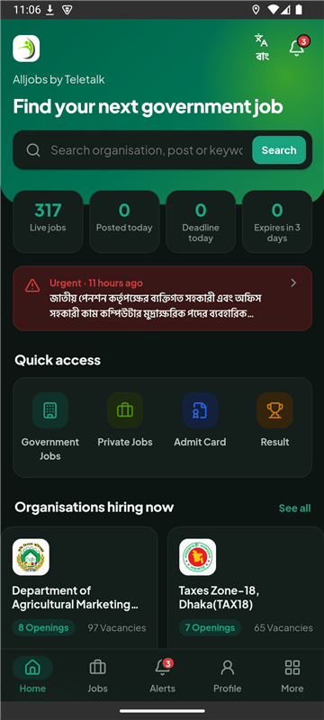
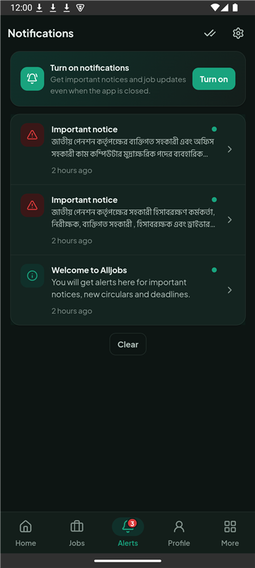
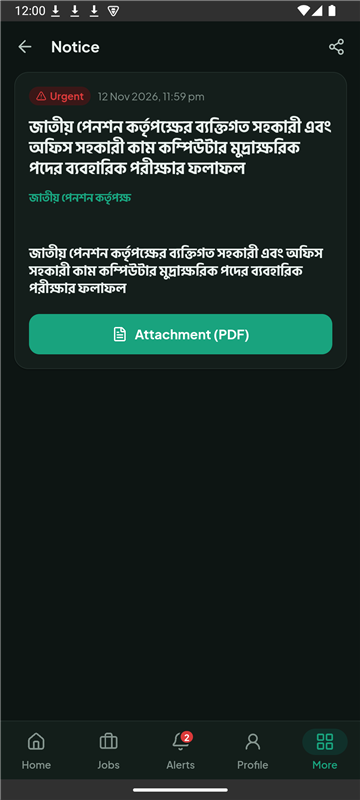
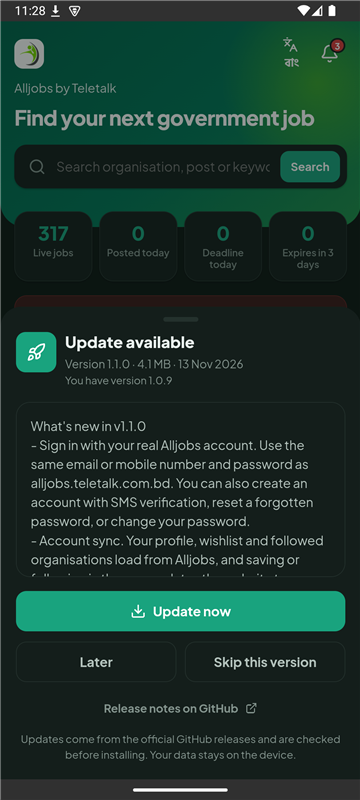

# Alljobs by Teletalk — Reimagined

**Government job circulars, admit cards, results and notices from Bangladesh, in a fast mobile app.**

 

  
  
  
  

## Features

- **Live government jobs.** Browse every circular on alljobs.teletalk.com.bd by organisation or by post. Search in English or Bangla, and filter by new today, deadline today or closing within 3 days.
- **Job details.** Countdown to the deadline, circular PDF, a check that you're within the age limit, and step-by-step help to apply on Teletalk and pay the fee by SMS.
- **Admit cards, results and notices,** with urgent notices highlighted.
- **Notifications** for important notices, new circulars (from all organisations or only ones you follow), deadline reminders for saved jobs, and admit cards or results for jobs you track. They arrive even when the app is closed.
- **Your Alljobs account.** Sign in with your alljobs.teletalk.com.bd account to see your full profile, your All Jobs User ID (with a copy button), wishlist, followed organisations and account notifications. Saving a job or following an organisation in the app updates the website too.
- **Applied jobs tracker** from application through fee payment, admit card, exam and result.
- **English / বাংলা,** light and dark themes, and it still works with the last loaded data when you're offline.
- **Automatic updates.** The app tells you when a new version is out and installs it for you.

## Install

1. On your Android phone, tap **[Download for Android](https://github.com/abdullah-al-faahim/Alljobs-by-Teletalk-Reimagined/releases/latest/download/Alljobs-Reimagined.apk)**.
2. Open the downloaded `Alljobs-Reimagined.apk`.
3. If Android asks, allow **Install unknown apps** for your browser or file manager, then tap **Install**.

After that, updates arrive inside the app: **Profile → Settings → App version → Check**.

All versions and their release notes are on the [Releases page](https://github.com/abdullah-al-faahim/Alljobs-by-Teletalk-Reimagined/releases).

## Is it safe?

- Every APK is signed with the same key. Android will only install an update signed with that key. The certificate's SHA-256 fingerprint is
  `d42036a30767866cdd84c207c1527382ec25577a8f8f620d8f82cdcf51774106`.
- The in-app updater only downloads from this repository's releases and checks the file's SHA-256 against the one GitHub publishes before installing.
- Your Alljobs password is sent only to alljobs.teletalk.com.bd. The app stores just your sign-in session on your phone.

## Feedback

Found a bug or have an idea? [Open an issue](https://github.com/abdullah-al-faahim/Alljobs-by-Teletalk-Reimagined/issues).

---

Unofficial concept work. Not affiliated with, or endorsed by, Teletalk Bangladesh Ltd. Job, notice and result data comes from the public alljobs.teletalk.com.bd website. The Alljobs name and logo belong to their owners. This repository contains releases only; the source code is private.
